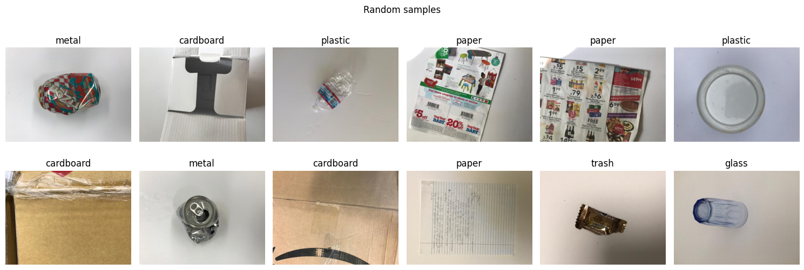
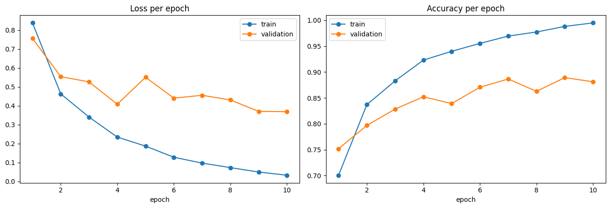
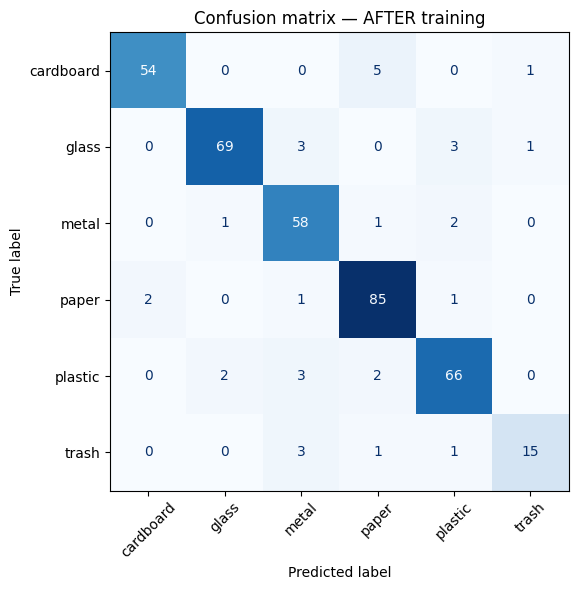
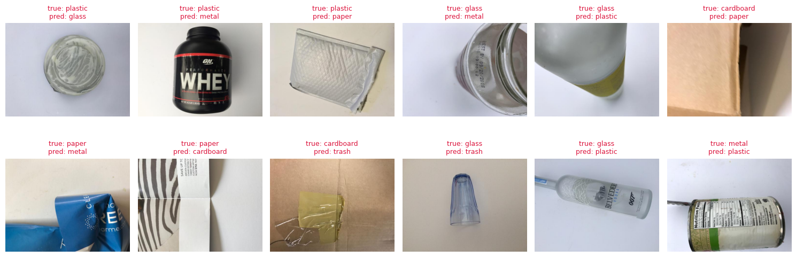

**SDAIA Academy · Computer Vision for Developers:** https://mibnrashid.github.io/SDAIA_ComputerVision/

# Garbage Classification with Transfer Learning

**Computer Vision for Developers, SDAIA Academy: Course Project**

## Project
Recycling plants still sort a lot of waste by hand. This project trains an image classifier that sorts waste photos into 6 material classes: **cardboard, glass, metal, paper, plastic, trash**. A model like this could guide an automatic sorting line.

## Dataset
- **Source:** [Garbage Classification on Kaggle](https://www.kaggle.com/datasets/asdasdasasdas/garbage-classification)
- **Size:** 2,527 images, 6 classes: cardboard 403 · glass 501 · metal 410 · paper 594 · plastic 482 · trash 137
- **Split:** stratified 70% train / 15% validation / 15% test (seed 42), giving 1,768 / 379 / 380 images. The test set is used only for the before and after evaluation.
- The notebook downloads the dataset with `kagglehub`. The dataset is not committed to this repo.



## Model
- **Architecture:** ResNet-18 pretrained on ImageNet (transfer learning). The final layer is replaced with a new head (Dropout 0.3, then Linear to 6 classes).
- **Fine-tuning:** layers 1–3 are frozen. `layer4` and the new head are trained.
- **Training:** AdamW, learning rate `1e-3` with a cosine schedule, weight decay `1e-4`, batch size `32`, `10` epochs, 224×224 input.
- **Augmentation:** random resized crop, horizontal flip, ±15° rotation, colour jitter.
- **Checkpoint:** the epoch with the best validation accuracy is kept.

## Results

### Learning curves


Training loss falls from 0.84 to 0.03 and validation loss falls from 0.76 to 0.37. The best validation accuracy is 88.9% at epoch 9, and that checkpoint is the one kept. There is mild overfitting (train accuracy 99.5% vs validation 88%), but validation loss does not rise, so the model still generalises. Training took 2.4 minutes on a T4.

### Before vs after (same test set)
| | Loss | Accuracy | Precision (macro) | Recall (macro) | F1 (macro) |
|---|---|---|---|---|---|
| Before training | 1.889 | 18.7% | 13.4% | 15.0% | 10.9% |
| After training | 0.285 | **91.3%** | **91.1%** | **89.2%** | **90.0%** |

Test set: 380 images. 33 of them are misclassified after training.

### Confusion matrix (after training)


**What changed and why:** before training, the new head has random weights, so its accuracy is close to chance (about 1/6). After training, the pretrained features are mapped to waste classes. The most common confusions are paper ↔ cardboard (7 errors) and glass ↔ plastic (5 errors), which are visually similar materials. **Trash** is the weakest class (recall 75%) because it has the fewest images (137).



## How to run
1. Open `project.ipynb` in Google Colab.
2. Go to **Runtime → Change runtime type → T4 GPU**.
3. *(Only if Kaggle asks for login)* add `KAGGLE_USERNAME` and `KAGGLE_KEY` in Colab **Secrets** (🔑).
4. Go to **Runtime → Run all**. Training takes about 5–10 minutes on a T4.

## Repo contents
```
README.md
project.ipynb     # saved with outputs
results/          # figures and metrics produced by the notebook
```
